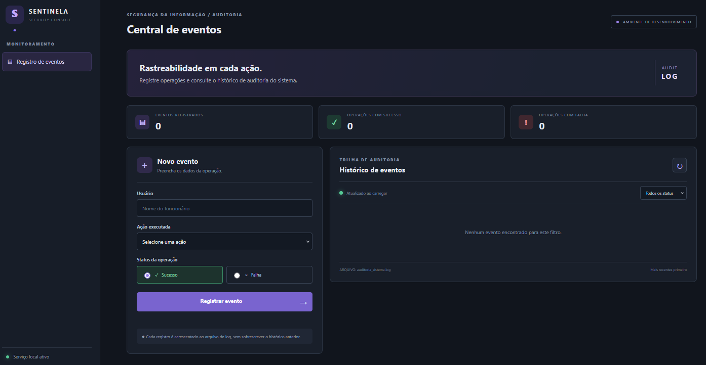
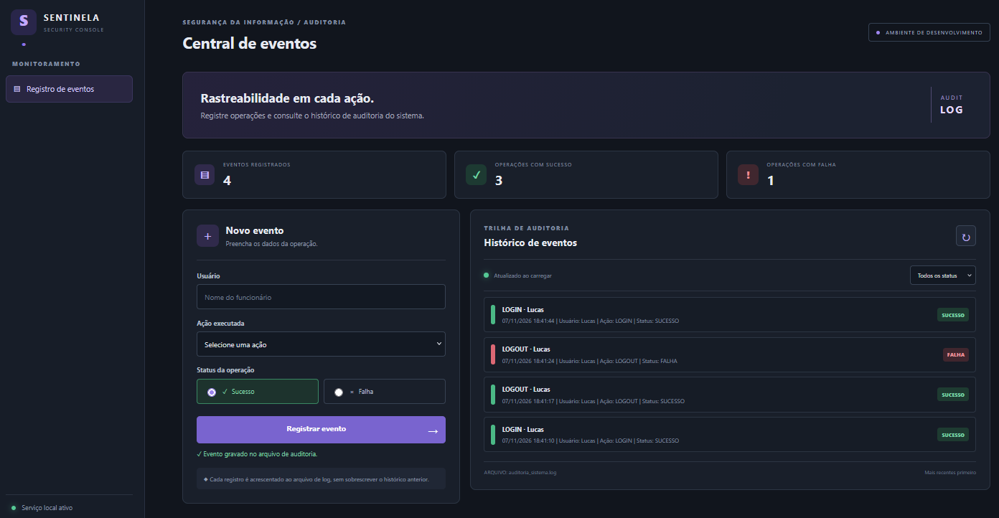

# Sentinela — Sistema de Auditoria de Eventos

Aplicação web didática para registrar e consultar ações realizadas por usuários em um sistema corporativo. O projeto nasceu de um exercício de Python sobre gravação de logs.

## Funcionalidades
- Registrar usuário, ação executada e status da operação.
- Gerar automaticamente data e hora do registro.
- Acrescentar eventos ao final do arquivo, sem apagar o histórico.
- Consultar eventos, com os mais recentes primeiro.
- Filtrar registros por sucesso ou falha.
- Exibir totais de eventos, sucessos e falhas.
- Validar os dados antes de gravar.

## 📸 Demonstração Visual

### Tela Inicial (Vazia)
Aguardando o registro do primeiro evento.


### Histórico de Eventos
Painel exibindo os eventos registrados, os contadores atualizados (Total, Sucessos e Falhas) e os cartões de cada operação com data, hora, usuário e status.


## Tecnologias
- **Backend:** Python 3 e Flask
- **Frontend:** HTML5, CSS3 e JavaScript
- **Armazenamento:** arquivo de texto (`auditoria_sistema.log`)

## Estrutura
```text
sentinela-auditoria-eventos/
├── app.py
├── requirements.txt
├── README.md
├── .gitignore
├── tests/
│   └── test_api.py
├── .github/workflows/ci.yml
├── auditoria_sistema.log  # criado automaticamente ao registrar o primeiro evento
├── templates/
│   └── index.html
└── static/
    ├── css/style.css
    └── js/app.js
```

## Como executar

### Pré-requisitos
- Python 3.10 ou superior
- pip

### 1. Clone o repositório e entre na pasta do projeto
```bash
git clone https://github.com/lucasmportela/sentinela-auditoria-eventos.git
cd sentinela-auditoria-eventos
```

### 2. Crie o ambiente virtual e instale as dependências

No Windows (PowerShell):

```powershell
py -m venv .venv
.\.venv\Scripts\python.exe -m pip install -r requirements.txt
```

No Windows (Prompt de Comando):

```cmd
py -m venv .venv
.venv\Scripts\python.exe -m pip install -r requirements.txt
```

No Linux/macOS:

```bash
python3 -m venv .venv
source .venv/bin/activate
python -m pip install -r requirements.txt
```

### 3. Inicie o servidor

Windows PowerShell:

```powershell
.\.venv\Scripts\python.exe app.py
```

Windows Prompt de Comando:

```cmd
.venv\Scripts\python.exe app.py
```

Linux/macOS:

```bash
python app.py
```

Abra http://127.0.0.1:5000 no navegador. O arquivo `auditoria_sistema.log` será criado automaticamente no primeiro registro.

## Regras de negócio
A função central segue a proposta do exercício:

```python
from datetime import datetime

def registrar_evento(usuario, acao, status):
    data_hora = datetime.now().strftime("%d/%m/%Y %H:%M:%S")
    with open("auditoria_sistema.log", "a", encoding="utf-8") as arquivo:
        arquivo.write(
            f"[{data_hora}] Usuário: {usuario} | "
            f"Ação: {acao} | Status: {status}\n"
        )
```

O modo `a` (*append*) acrescenta a linha ao final do arquivo e preserva os registros anteriores. A interface disponibiliza as ações `LOGIN`, `LOGOUT`, `SAQUE`, `DEPOSITO`, `EXCLUSAO`, `EDICAO` e `CONSULTA`, com status `SUCESSO` ou `FALHA`.

## Testes automatizados

Os testes usam `unittest` e o cliente de testes do Flask. O arquivo de auditoria é redirecionado para um diretório temporário durante os testes, sem alterar o log local.

Execute na raiz do projeto:

```bash
python -m unittest discover -s tests -v
```

A suíte valida a página inicial, listagem, criação de eventos, validação de campos, ordem dos registros, persistência em arquivo e preservação do histórico. O GitHub Actions executa os testes e a verificação de sintaxe em cada push e pull request.

## API

| Método | Rota | Descrição |
|---|---|---|
| GET | `/api/eventos` | Lista eventos gravados |
| POST | `/api/eventos` | Valida e registra um novo evento |

Exemplo de corpo JSON:
```json
{
  "usuario": "Lucas",
  "acao": "LOGIN",
  "status": "SUCESSO"
}
```

Exemplo de linha gravada:
```text
[07/11/2026 14:30:00] Usuário: Lucas | Ação: LOGIN | Status: SUCESSO
```

## Nota de segurança
Projeto para estudo. Um arquivo local editável não garante uma trilha de auditoria inviolável. Em produção, implemente autenticação e controle de acesso, armazenamento centralizado, proteção contra adulteração, rotação e retenção de logs, sincronização de horário e monitoração. O Debug fica desativado por padrão e o servidor escuta em `127.0.0.1`. Para habilitá-lo apenas durante o desenvolvimento local, defina `FLASK_DEBUG=true`. Quando `APP_ENV=production`, o Debug permanece desativado. Não exponha o servidor de desenvolvimento diretamente à internet.    