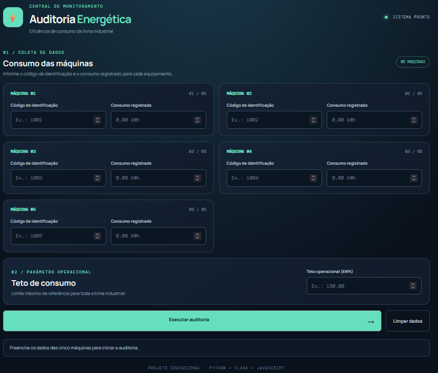
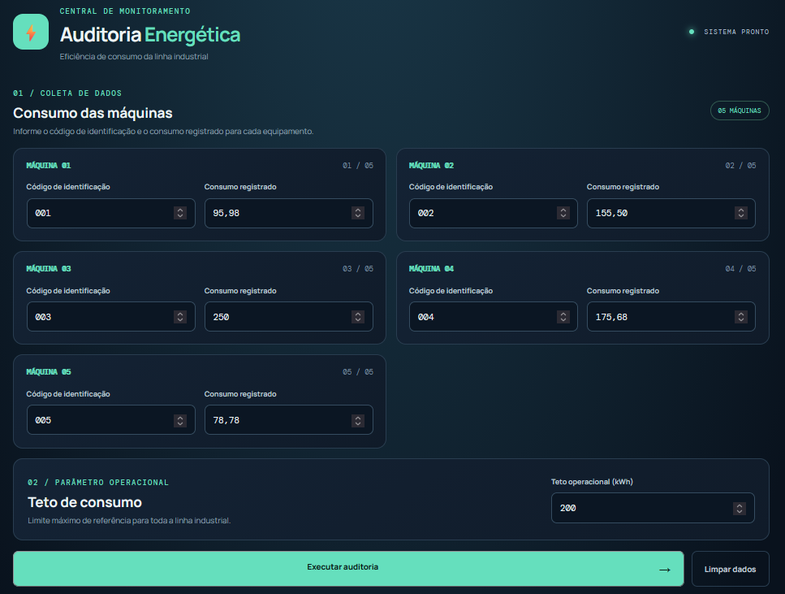
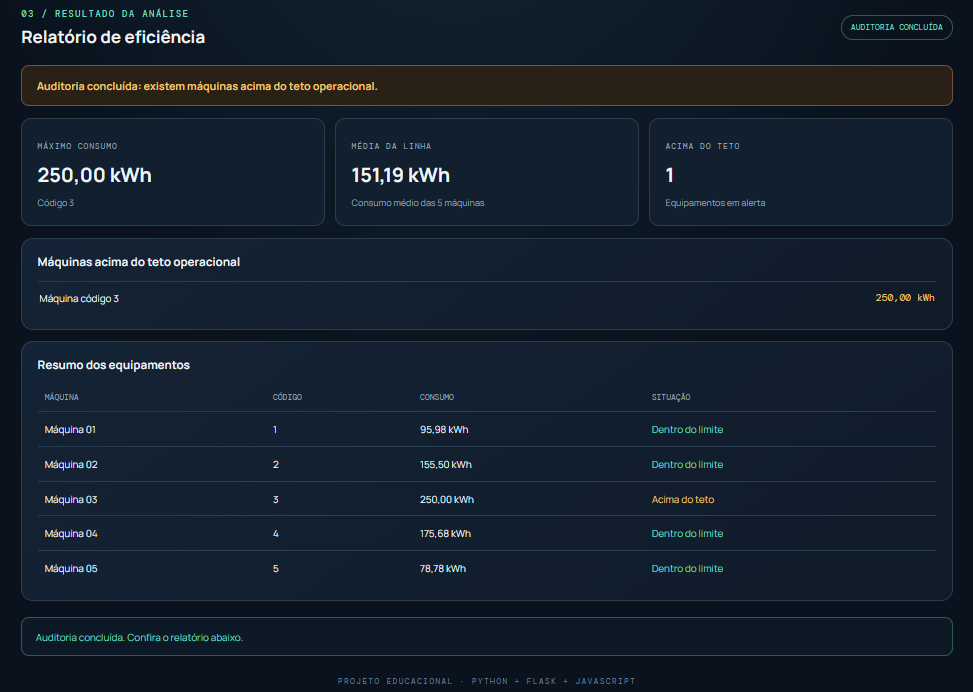

# Auditoria de Eficiência Energética Industrial

Aplicação web baseada no exercício de lógica de programação que audita o consumo elétrico de cinco máquinas de uma linha industrial. O sistema compara os consumos com um teto operacional, identifica equipamentos acima do limite, encontra o maior consumo e calcula a média da planta.

## Funcionalidades

- Cadastro de cinco máquinas com código de identificação e consumo em kWh.
- Validação para aceitar somente consumos maiores que zero.
- Definição de um teto operacional único para a linha.
- Identificação de todas as máquinas que ultrapassaram o teto.
- Identificação da máquina com maior consumo absoluto.
- Cálculo da média aritmética dos cinco consumos.
- Relatório visual com situação individual de cada máquina.
- Mensagem **“Operação Dentro dos Parâmetros de Eficiência”** quando nenhuma máquina ultrapassa o teto.

## 📸 Demonstração Visual

### Tela Inicial (Vazia)
Aguardando o registro das primeiras máquinas, seus respectivos consumos e o teto operacional.


### Entrada dos dados
Campos preenchidos com as informações necessárias para o processamento.


### Resultado do processamento
Resultado do processamento detalhado com o nome, código, consumo e situação de cada máquina. Exibição de maior e
consumo médio da linha e se tem alguma máquina acima dos teto de consumo.


## Tecnologias

- **Backend:** Python 3 e Flask.
- **Frontend:** HTML5, CSS3 e JavaScript.
- **Comunicação:** API HTTP com JSON.

## Estrutura do projeto

```text
AuditoriaEnergeticaIndustrial/
├── backend/
│   ├── app.py
│   └── requirements.txt
├── frontend/
│   ├── index.html
│   ├── style.css
│   └── app.js
└── README.md
```

## Como executar

### Pré-requisitos

- Python 3.10 ou superior.
- pip.

### 1. Clone o repositório e entre na pasta do projeto

```bash
git clone https://github.com/lucasmportela/lucasmportela.git
cd lucasmportela/AuditoriaEnergeticaIndustrial
```

### 2. (Opcional) Crie um ambiente virtual

Windows PowerShell:

```powershell
python -m venv .venv
.venv\Scripts\Activate.ps1
```

### 3. Instale as dependências

```bash
pip install -r backend/requirements.txt
```

### 4. Inicie o backend

```bash
python backend/app.py
```

### 5. Acesse no navegador

```text
http://127.0.0.1:5000
```

> Abra a aplicação pelo endereço do Flask. Não abra o `index.html` diretamente nem use o Live Server, pois o frontend precisa acessar a API do backend.

## Regras de negócio

| Regra | Comportamento |
|---|---|
| Quantidade de máquinas | Exatamente 5 |
| Código da máquina | Número inteiro não negativo |
| Consumo | Número real estritamente maior que zero |
| Teto operacional | Número real maior que zero |
| Máquina em alerta | Consumo maior que o teto |
| Maior consumo | Identificado por varredura das cinco posições |
| Média | Soma dos cinco consumos dividida por 5 |

A comparação segue o enunciado: somente consumos **maiores** que o teto são considerados excedentes. Um consumo exatamente igual ao teto permanece dentro do limite.

## Restrição técnica do exercício

O backend mantém dois vetores paralelos (`num_ident` e `consumo`) e percorre as cinco posições com índices explícitos. A identificação do maior consumo e o cálculo da soma/média são realizados manualmente durante a varredura, sem utilizar `max()`, `min()` ou `sum()`.

A interface web facilita a entrada dos dados, mas as regras e os cálculos são validados e executados no backend Python.

## Rota da API

| Método | Rota | Descrição |
|---|---|---|
| GET | `/` | Exibe a interface web. |
| POST | `/api/auditoria` | Valida os dados e executa a auditoria. |

Exemplo de requisição:

```json
{
  "maquinas": [
    {"codigo": 101, "consumo": 120.5},
    {"codigo": 102, "consumo": 98.0},
    {"codigo": 103, "consumo": 145.2},
    {"codigo": 104, "consumo": 110.0},
    {"codigo": 105, "consumo": 87.4}
  ],
  "teto": 130.0
}
```

## Observações

Este é um projeto educacional. Os dados são enviados para a API para processamento e não são persistidos em banco de dados.

## Autor

Projeto desenvolvido para praticar lógica de programação, vetores paralelos, laços de repetição, validação de dados, Python e desenvolvimento web.
