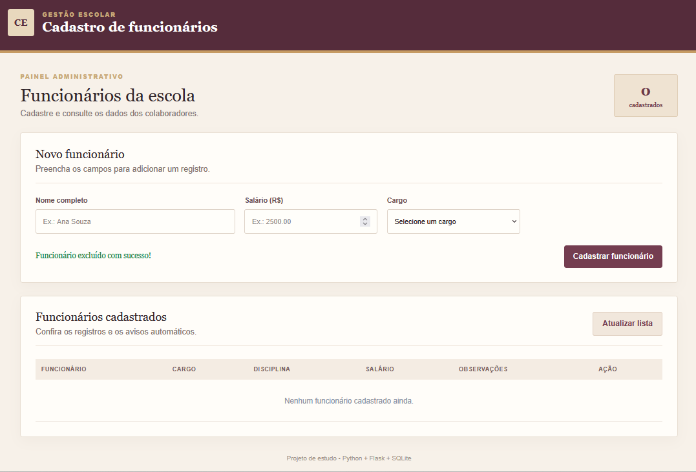
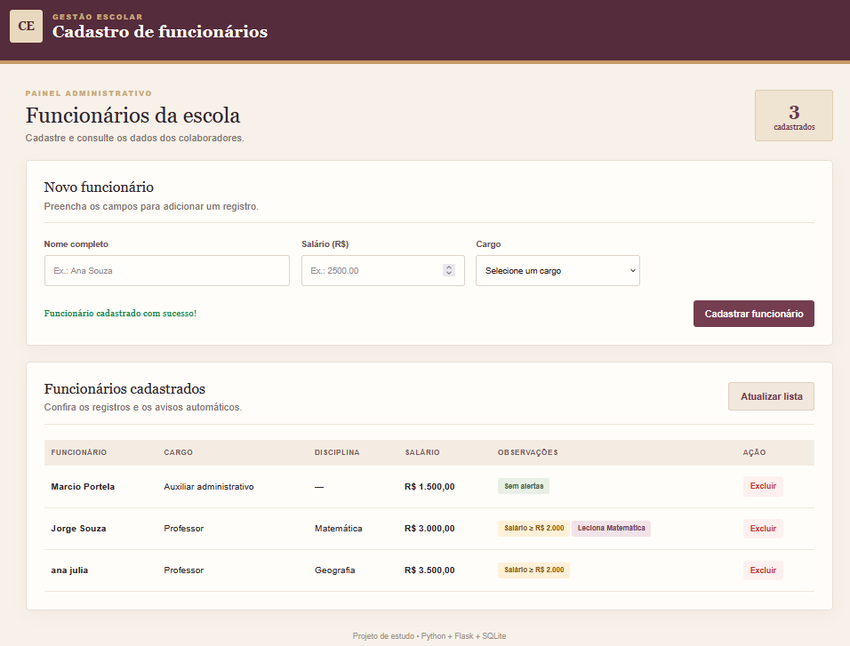

# Cadastro de Funcionários da Escola

Aplicação web para cadastrar e consultar funcionários de uma escola. O projeto foi desenvolvido a partir de um exercício de Programação Orientada a Objetos em Python.

## 📸 Demonstração Visual

### Tela Inicial (Vazia)
Aguardando o registro dos primeiros nomes de funcionários, salários e cargos.


### Histórico de Eventos
Painel exibindo os eventos registrados, os funcionários registrados, os salários e as observações.


## Tecnologias

- **Backend:** Python 3 e Flask
- **Frontend:** HTML5, CSS3 e JavaScript
- **Banco de dados:** SQLite

## Funcionalidades

- Cadastrar funcionários com nome, salário e cargo.
- Solicitar a disciplina quando o cargo for Professor.
- Destacar professores que lecionam Matemática.
- Exibir um aviso para salários iguais ou superiores a R$ 2.000,00.
- Listar os funcionários cadastrados.
- Excluir funcionários.
- Armazenar os dados em um banco SQLite local.

## Estrutura do projeto

```text
CadastroFuncionariosEscola/
├── app.py
├── requirements.txt
├── README.md
├── .gitignore
├── funcionarios.db       # criado automaticamente ao executar o backend
├── templates/
│   └── index.html
└── static/
    ├── css/
    │   └── style.css
    └── js/
        └── app.js
```

## Como executar localmente

### 1. Pré-requisitos

- Python 3.10 ou superior
- pip

### 2. Clone o repositório e entre na pasta

\`\`\`bash
git clone https://github.com/lucasmportela/lucasmportela.git
cd lucasmportela/CadastroFuncionariosEscola
\`\`\`

### 3. Crie o ambiente virtual e instale as dependências

No Windows (PowerShell):

\`\`\`powershell
py -m venv .venv
.\.venv\Scripts\python.exe -m pip install -r requirements.txt
\`\`\`

No Windows (Prompt de Comando):

\`\`\`cmd
py -m venv .venv
.venv\Scripts\python.exe -m pip install -r requirements.txt
\`\`\`

No Linux/macOS:

\`\`\`bash
python3 -m venv .venv
source .venv/bin/activate
python -m pip install -r requirements.txt
\`\`\`

### 4. Inicie a aplicação

Windows PowerShell:

\`\`\`powershell
.\.venv\Scripts\python.exe app.py
\`\`\`

Windows Prompt de Comando:

\`\`\`cmd
.venv\Scripts\python.exe app.py
\`\`\`

Linux/macOS:

\`\`\`bash
python app.py
\`\`\`

Abra no navegador:

http://127.0.0.1:5000

O banco `funcionarios.db` e a tabela de funcionários são criados automaticamente na primeira execução.

## Regras de negócio

- Todos os funcionários precisam ter nome, salário e cargo.
- O salário não pode ser negativo.
- Quando o cargo for `Professor`, a disciplina é obrigatória.
- Funcionários com salário maior ou igual a R$ 2.000,00 recebem um aviso.
- Professores cuja disciplina seja Matemática recebem uma identificação especial.

## Rotas da API

| Método | Rota | Descrição |
|---|---|---|
| GET | `/api/funcionarios` | Lista todos os funcionários |
| POST | `/api/funcionarios` | Cadastra um funcionário |
| DELETE | `/api/funcionarios/<id>` | Exclui um funcionário |

### Exemplo de cadastro (JSON)

```json
{
  "nome": "Maria Oliveira",
  "salario": 2500,
  "cargo": "Professor",
  "disciplina": "Matemática"
}
```

## Observações

Este projeto é uma aplicação didática para estudo de Python, APIs, frontend e banco de dados. Para uso em produção, recomenda-se adicionar autenticação, autorização, testes automatizados e configurações de segurança.
