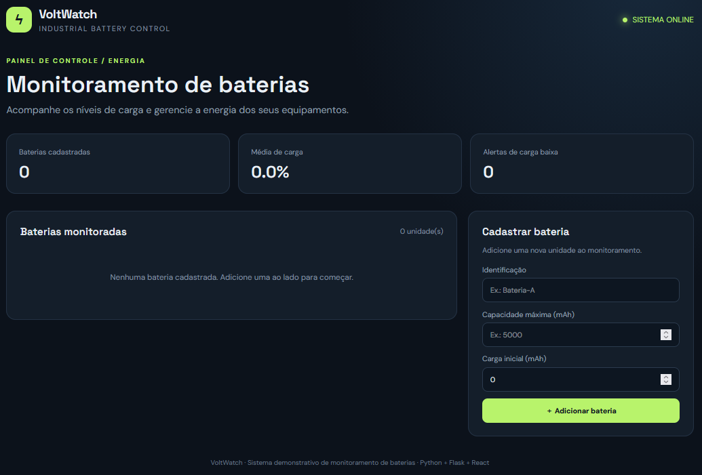
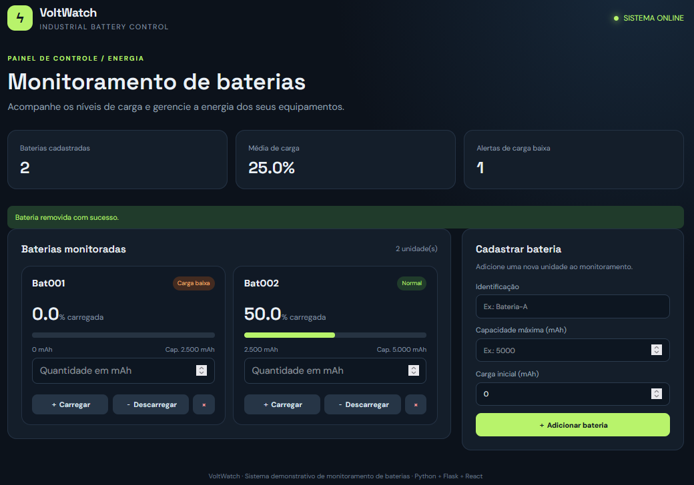

# VoltWatch — Sistema de Monitoramento de Baterias

Aplicação web para cadastrar baterias industriais, acompanhar o nível de carga e executar operações de carregamento e descarregamento com validação de limites.

## Funcionalidades

- Cadastro de baterias com identificação, capacidade máxima e carga inicial.
- Visualização da porcentagem de carga em tempo real após cada operação.
- Alerta visual quando a carga fica abaixo de 20%.
- Carregamento sem ultrapassar a capacidade máxima.
- Descarregamento sem permitir carga negativa.
- Remoção de baterias cadastradas.
- Validações realizadas no backend em Python.

## Demonstração Visual

### Tela Inicial (Vazia)
Aguardando as identificações das baterias, carga máxima e carga atual.


### Preenchido
tela com as baterias cadastradas para o monitoramento com as opções de descarregar, carregar e remover.


## Tecnologias

- **Backend:** Python 3, Flask e Flask-CORS.
- **Frontend:** React 18, JavaScript, HTML e CSS.
- **Comunicação:** API REST com JSON.

> O frontend usa React por CDN e é servido pelo Flask. Assim, não é necessário instalar Node.js, Vite ou configurar um processo de build.

## Estrutura do projeto

```text
MonitoramentoDeBaterias/
│
├── backend/
│   ├── app.py
│   └── requirements.txt
│
├── frontend/
│   ├── index.html
│   ├── app.jsx
│   └── style.css
│
├── .gitignore
└── README.md
```

## Requisitos

- Python 3.10 ou superior.
- Navegador atualizado.
- Conexão com a internet na primeira abertura para carregar React e Babel via CDN.

## Como executar

### 1. Clone o repositório e entre na pasta do projeto

\`\`\`bash
git clone https://github.com/lucasmportela/lucasmportela.git
cd lucasmportela/MonitoramentoDeBaterias
\`\`\`

### 2. Crie o ambiente virtual

Windows (PowerShell ou Prompt de Comando):

\`\`\`powershell
py -m venv .venv
\`\`\`

Linux/macOS:

\`\`\`bash
python3 -m venv .venv
source .venv/bin/activate
\`\`\`

### 3. Instale as dependências

Windows PowerShell:

\`\`\`powershell
.\.venv\Scripts\python.exe -m pip install -r backend/requirements.txt
\`\`\`

Windows Prompt de Comando:

\`\`\`cmd
.venv\Scripts\python.exe -m pip install -r backend/requirements.txt
\`\`\`

Linux/macOS:

\`\`\`bash
python -m pip install -r backend/requirements.txt
\`\`\`

### 4. Inicie o servidor

Windows PowerShell:

\`\`\`powershell
.\.venv\Scripts\python.exe backend/app.py
\`\`\`

Windows Prompt de Comando:

\`\`\`cmd
.venv\Scripts\python.exe backend/app.py
\`\`\`

Linux/macOS:

\`\`\`bash
python backend/app.py
\`\`\`

### 5. Acesse a aplicação

Abra no navegador:

\`\`\`text
http://127.0.0.1:5000
\`\`\`

## Rotas da API

| Método | Rota | Descrição |
|---|---|---|
| GET | `/api/baterias` | Lista todas as baterias |
| POST | `/api/baterias` | Cadastra uma bateria |
| POST | `/api/baterias/<id>/carregar` | Adiciona carga |
| POST | `/api/baterias/<id>/descarregar` | Retira carga |
| DELETE | `/api/baterias/<id>` | Remove uma bateria |

### Exemplo de cadastro

Requisição `POST /api/baterias`:

```json
{
  "identificacao": "Bateria-A",
  "capacidade_maxima": 5000,
  "carga_atual": 2000
}
```

### Exemplo de carregamento

Requisição `POST /api/baterias/ID_DA_BATERIA/carregar`:

```json
{
  "mah": 1500
}
```

## Regras de negócio

- A capacidade máxima deve ser maior que zero e não pode ser alterada depois da criação.
- A carga atual deve permanecer entre zero e a capacidade máxima.
- A porcentagem é calculada por `(carga_atual / capacidade_maxima) * 100`.
- A bateria é considerada fraca quando está abaixo de 20%.
- Uma operação de carga ou descarga precisa receber uma quantidade maior que zero.
- O backend rejeita operações que ultrapassem a capacidade ou deixem a carga negativa.

## Observações

Os dados ficam armazenados em memória. Portanto, são perdidos quando o servidor é reiniciado. Para uma versão de produção, recomenda-se integrar um banco de dados, como SQLite ou PostgreSQL, e desativar o modo `debug`.

## Objetivo

Projeto desenvolvido como prática de Programação Orientada a Objetos em Python, encapsulamento, propriedades (`@property`), validação de dados, criação de API REST e integração entre frontend e backend.
