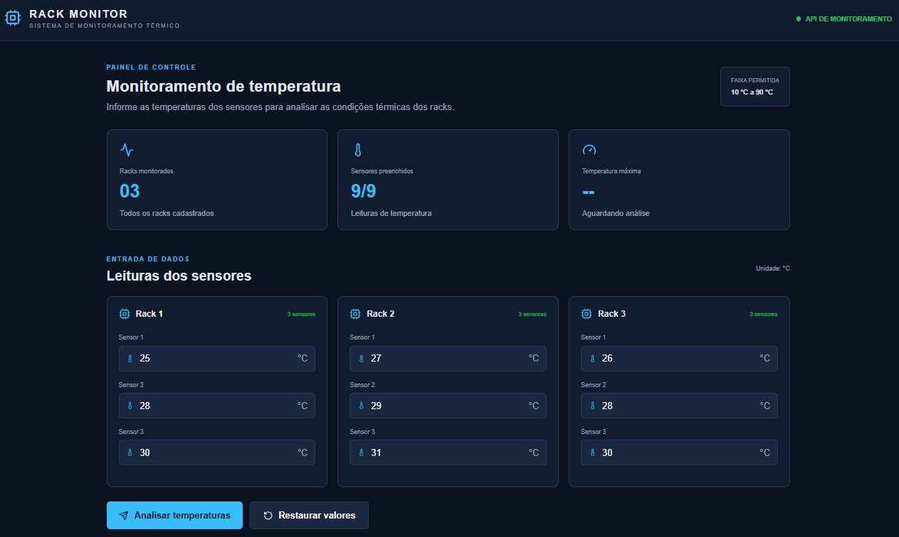
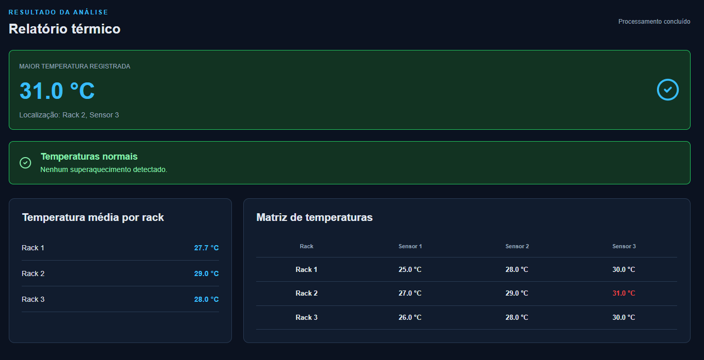
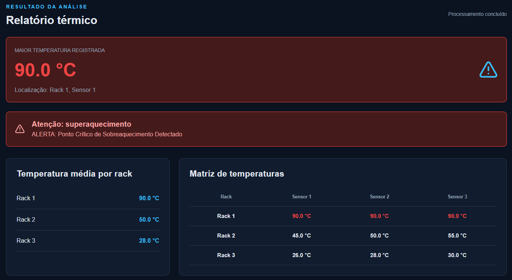

# 🌡️ Rack Monitor — Monitoramento Térmico de Data Centers

Aplicação web para simular o monitoramento térmico de três racks de servidores, com três sensores por rack. O sistema recebe as temperaturas, calcula a média de cada rack, identifica a maior leitura e alerta quando algum sensor atinge **75 °C ou mais**.

## Funcionalidades

- Entrada de temperatura para 9 sensores (3 racks × 3 sensores).
- Validação de temperaturas entre 10 °C e 90 °C.
- Cálculo da média de temperatura de cada rack.
- Identificação da maior temperatura e sua localização (rack e sensor).
- Alerta de superaquecimento a partir de 75 °C.
- Exibição dos resultados em painel e tabela.
- API REST para processar a matriz de temperaturas.
- Execução local ou com Docker Compose.

## 📸 Demonstração Visual

### Tela Inicial (Vazia)
Aguardando o registro dos valores de temperatura dos sensores dos racks.


### Relatório
Relatório térmico com as médias por rack, a matriz de temperaturas, a maior leitura e o status atual.


### Alerta
Alerta exibido quando alguma temperatura atinge 75 °C ou mais.


## Tecnologias

**Frontend:** React, Vite, JavaScript, CSS e Lucide React.  
**Backend:** Node.js, Express e CORS.  
**Infraestrutura:** Docker, Docker Compose e Nginx.

## Configuração de CORS

A API não libera acesso CORS para qualquer origem. Por padrão, somente as origens locais do Vite abaixo são autorizadas:

- `http://localhost:5173`
- `http://127.0.0.1:5173`

Para permitir o frontend hospedado em outro endereço, configure a variável de ambiente `CORS_ORIGINS` com a origem exata, incluindo protocolo e porta quando necessário. Para múltiplas origens, separe os endereços por vírgula.

Exemplo para produção:

```env
CORS_ORIGINS=https://app.seu-dominio.com
```

No Docker Compose, copie `.env.example` para `.env` e ajuste essa variável. Não use curingas (`*`) nem inclua domínios que não controlam o frontend.

O frontend local e a versão Docker utilizam proxies do Vite e do Nginx para encaminhar as chamadas `/api`; quando a chamada é feita pela mesma origem da página, não é necessário liberar um domínio adicional no CORS.

Para executar o backend localmente com uma origem adicional, defina a variável antes de iniciar o servidor:

**Windows PowerShell:**

```powershell
$env:CORS_ORIGINS = "https://app.seu-dominio.com"
```

**Git Bash, Linux ou macOS:**

```bash
export CORS_ORIGINS="https://app.seu-dominio.com"
```

Para Docker Compose, copie `.env.example` para `.env` na raiz do projeto e ajuste o valor de `CORS_ORIGINS`.

## Estrutura do projeto

```text
MonitoramentoRackDataCenter/
├── backend/
│   ├── tests/
│   │   └── monitoramento.test.js
│   ├── DOCKERFILE
│   ├── package.json
│   └── server.js
├── frontend/
│   ├── DOCKERFILE
│   ├── index.html
│   ├── nginx.conf
│   ├── package.json
│   ├── vite.config.js
│   └── src/
│       ├── App.jsx
│       ├── main.jsx
│       └── style.css
├── .dockerignore
├── .gitignore
├── docker-compose.yml
└── README.md
```

## Regras de negócio

- A matriz deve conter exatamente 3 racks.
- Cada rack deve conter exatamente 3 sensores.
- Cada temperatura deve ser um número entre 10 °C e 90 °C.
- Uma leitura igual ou superior a 75 °C ativa o alerta de superaquecimento.
- As médias são calculadas individualmente para cada rack.
- A localização da maior leitura é apresentada com numeração iniciada em 1 na interface.

## Executar localmente

### Pré-requisitos

- Node.js 20 ou superior e npm instalados.
- Git instalado.

### 1. Clone o repositório e entre na pasta do projeto

```bash
git clone https://github.com/lucasmportela/Rack-Monitor-Monitoramento-Termico-de-Data-Centers.git
cd Rack-Monitor-Monitoramento-Termico-de-Data-Centers
```

### 2. Iniciar o backend

Abra um terminal na raiz do projeto.

**Windows PowerShell:**

```powershell
cd backend
npm.cmd install
npm.cmd run dev
```

**Git Bash, Linux ou macOS:**

```bash
cd backend
npm install
npm run dev
```

A API ficará disponível em `http://localhost:3001`. Verifique o status abrindo `http://localhost:3001/` no navegador.

### 3. Iniciar o frontend

Abra outro terminal na raiz do projeto.

**Windows PowerShell:**

```powershell
cd frontend
npm.cmd install
npm.cmd run dev
```

**Git Bash, Linux ou macOS:**

```bash
cd frontend
npm install
npm run dev
```

Acesse `http://localhost:5173`. O Vite encaminha automaticamente as requisições iniciadas por `/api` para o backend em `http://localhost:3001`.

## Executar com Docker

Com Docker e Docker Compose instalados, execute na raiz:

```bash
docker compose up --build
```

Acesse `http://localhost:8080`. Para parar os containers:

```bash
docker compose down
```

## API

### `GET /`

Retorna uma mensagem indicando que a API está online.

### `POST /api/monitoramento`

Recebe uma matriz de três racks, cada um com três temperaturas.

Exemplo de requisição:

```json
{
  "matriz": [
    [25.5, 30.0, 35.2],
    [40.0, 45.5, 50.0],
    [60.0, 70.0, 78.5]
  ]
}
```

A resposta contém a matriz validada, as médias por rack, a maior temperatura, a localização do sensor mais quente, o indicador de alerta e uma mensagem.

## Testes automatizados

Os testes de integração usam o módulo nativo `node:test` e fazem requisições HTTP à API Express real, sem dependências adicionais de teste.

Na pasta do backend, instale as dependências e execute:

```bash
npm install
npm test
```

A suíte cobre **21 cenários**, incluindo:

- Rota de status da API.
- Processamento de matriz 3×3 e cálculo das médias.
- Identificação da maior temperatura e sua localização.
- Temperaturas nos limites permitidos e valores inválidos.
- Alerta abaixo, exatamente em e acima de 75 °C.
- Matrizes e racks com quantidades incorretas de sensores.
- Corpos JSON nulos ou malformados e campos ausentes.
- CORS: origens locais autorizadas, origens externas não autorizadas e requisições preflight.

## Melhorias futuras

- Integração com sensores físicos.
- Persistência de histórico em banco de dados.
- Atualização automática das leituras.
- Autenticação e gerenciamento de usuários.
- Gráficos históricos e notificações.

## Autor

Projeto de estudo voltado ao desenvolvimento web, integração frontend/backend e monitoramento de infraestrutura de TI.
