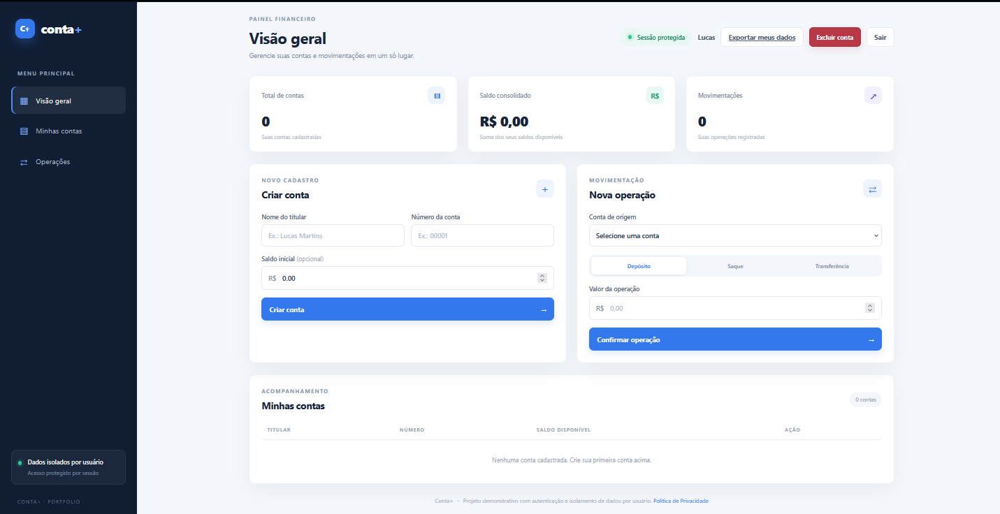
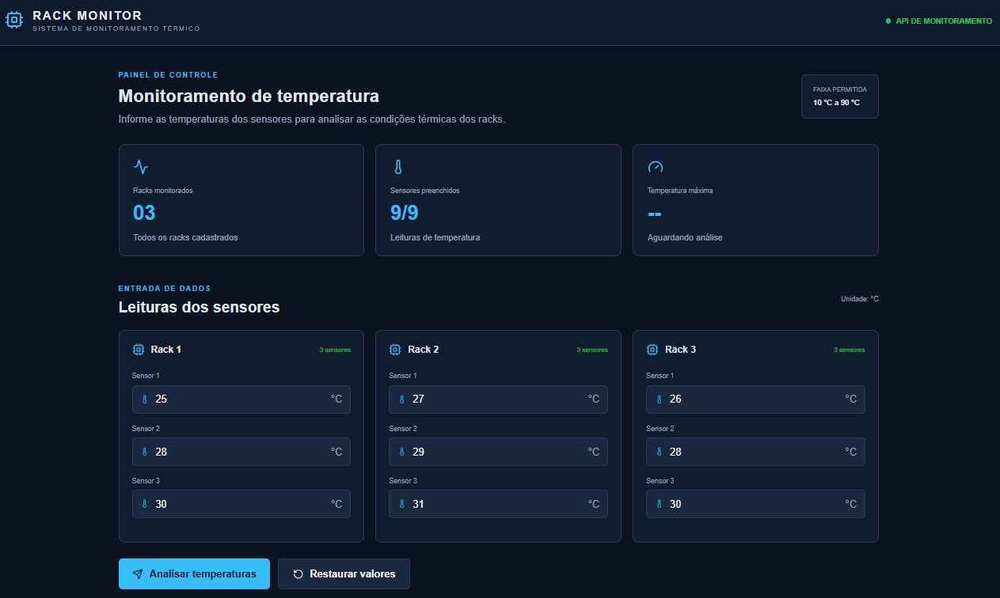
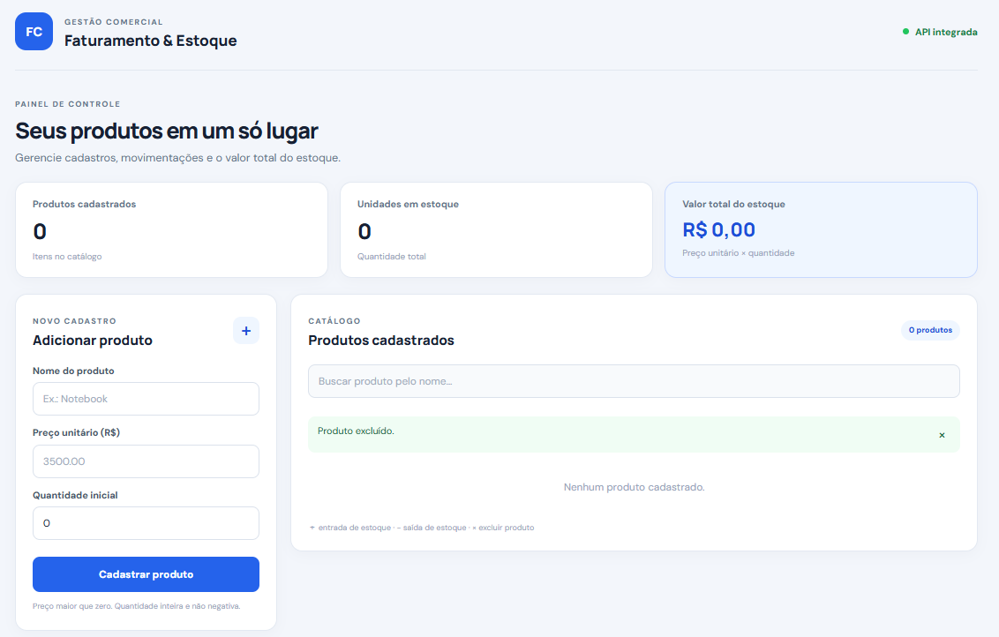
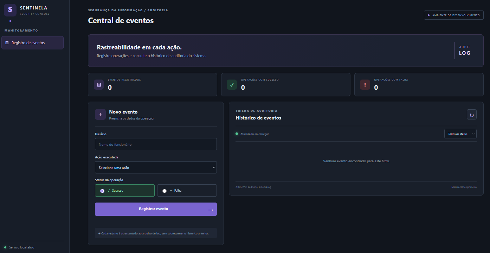
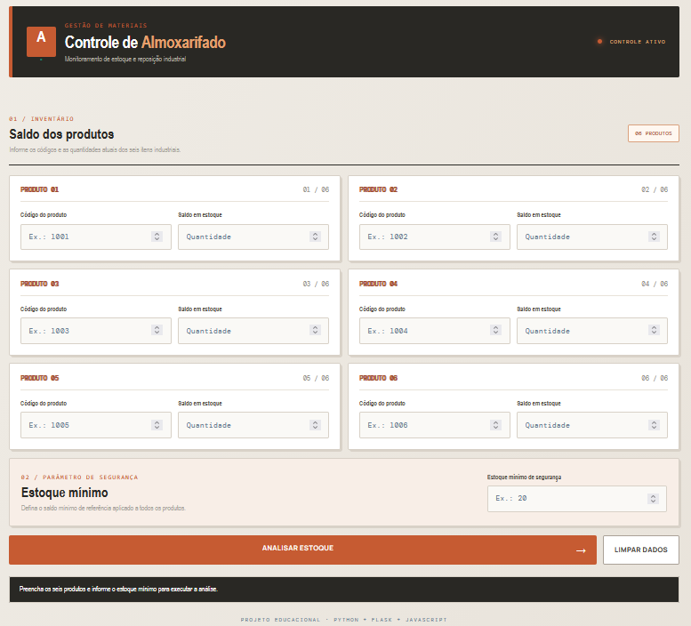
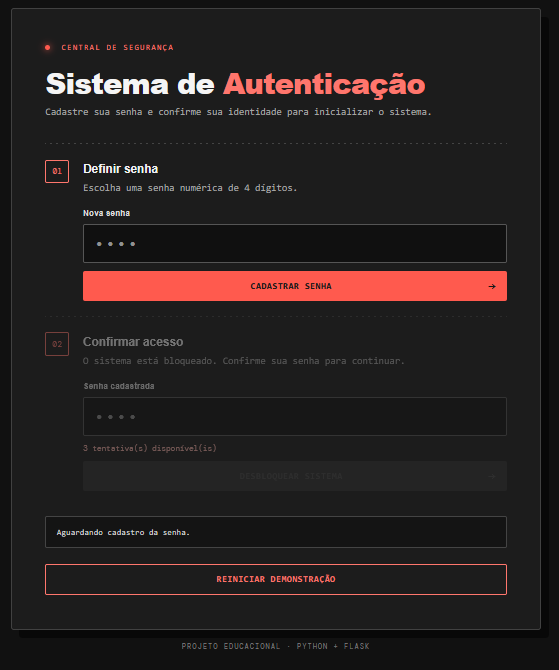
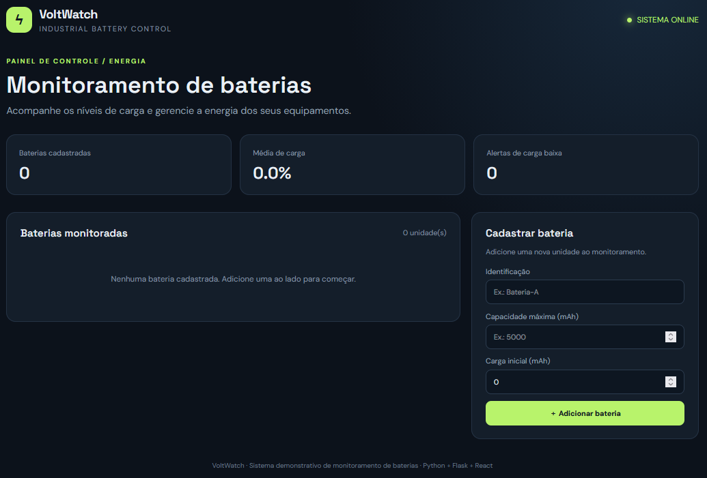
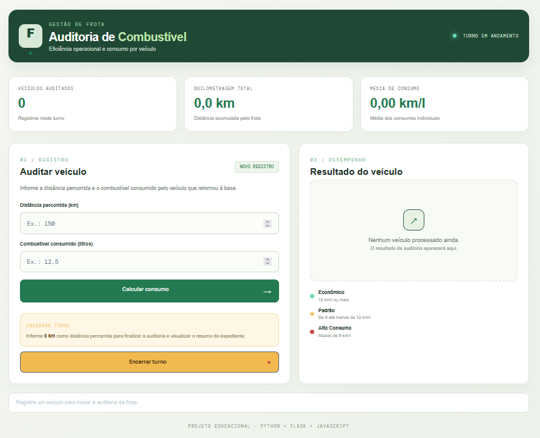

# Olá! Eu sou Lucas Martins Portela 

### Desenvolvedor Back-end Júnior | Junior Back-end Developer

**Transformando ideias em soluções através da programação.**  
*Turning ideas into solutions through programming.*

---

## Sobre mim | About me

**Português**

Sou desenvolvedor em formação, com foco em desenvolvimento back-end e interesse em construir aplicações úteis, organizadas e bem documentadas.

Desenvolvo projetos práticos para aprimorar minha lógica de programação, manipulação de dados, criação de APIs REST e integração entre back-end e interfaces web. Gosto de aprender colocando a mão no código, investigar problemas e transformar requisitos em funcionalidades.

**English**

I'm an aspiring developer focused on back-end development and interested in building useful, well-organized, and well-documented applications.

I work on practical projects to improve my programming logic, data handling, REST API development, and integration between back-end services and web interfaces.

## Tecnologias e ferramentas | Tech stack

**Linguagens | Languages**

**Back-end, banco de dados e ferramentas | Back-end, databases & tools**

**Front-end | Interface**

## Projetos em destaque | Featured projects

Projetos selecionados do meu portfólio. Acesse os repositórios para consultar o código, a documentação e as instruções de execução.

Selected projects from my portfolio. Visit the repositories to explore the source code, documentation, and setup instructions.

### 1. [Conta+ — Sistema de Contas Bancárias](https://github.com/lucasmportela/conta-mais)

Aplicação web para cadastro e gerenciamento de contas bancárias, com depósitos, saques, transferências e consulta de extratos. Inclui validações, painel de indicadores e persistência local em SQLite.

**Tecnologias:** Python, Flask, SQLite, HTML5, CSS3 e JavaScript.

<a href="SistemaContasBancarias/docs/screenshots/">Ver capturas de tela</a>

### 2. [Rack Monitor — Monitoramento Térmico de Data Centers](https://github.com/lucasmportela/rack-monitor)

Sistema de monitoramento térmico de racks e sensores, com visualização de temperaturas e alertas.

**Tecnologias:** JavaScript, Node.js, React, API REST e Docker.

<a href="MonitoramentoRackDataCenter/docs/screenshots/">Ver capturas de tela</a>

### 3. [Sistema de Faturamento de Produtos](https://github.com/lucasmportela/sistema-faturamento-produtos)

Aplicação para cadastro e gerenciamento de produtos, com regras de negócio e operações de faturamento.

**Tecnologias:** Python, Flask, React e JSON.

<a href="SistemaDeFaturamentoDeProdutos/docs/screenshots/">Ver capturas de tela</a>

### 4. [Auditoria de Eventos do Sistema](https://github.com/lucasmportela/sentinela-auditoria-eventos)

Projeto para registrar, consultar e acompanhar eventos do sistema, com operações de API e validações.

**Tecnologias:** Python e Flask.

<a href="AuditoriaDeEventosSistema/docs/screenshots/">Ver capturas de tela</a>

### 5. [Controle de Reposição de Almoxarifado](https://github.com/lucasmportela/lucasmportela/tree/main/ControleReposicaoAlmoxarifado)

Sistema de apoio ao controle de estoque e identificação de necessidades de reposição.

<a href="ControleReposicaoAlmoxarifado/docs/screenshots/">Ver capturas de tela</a>

### 6. [Sistema de Autenticação](https://github.com/lucasmportela/lucasmportela/tree/main/SistemaAutenticacao)

Aplicação demonstrativa de autenticação, validação de senha e controle de tentativas de acesso.

<a href="SistemaAutenticacao/docs/screenshots/">Ver capturas de tela</a>

### 7. [Monitoramento de Baterias](https://github.com/lucasmportela/lucasmportela/tree/main/MonitoramentoDeBaterias)

Projeto de monitoramento de carga de baterias, com validação de valores e regras de negócio.

<a href="MonitoramentoDeBaterias/docs/screenshots/">Ver capturas de tela</a>

### 8. [Auditoria de Consumo de Combustível](https://github.com/lucasmportela/lucasmportela/tree/main/AuditoriaConsumoCombustivel)

Aplicação para registrar e analisar informações de consumo de combustível.

<a href="AuditoriaConsumoCombustivel/docs/screenshots/">Ver capturas de tela</a>

## Outros projetos | Other projects

| Projeto | Descrição |
|---|---|
| [Auditoria Energética Industrial](https://github.com/lucasmportela/lucasmportela/tree/main/AuditoriaEnergeticaIndustrial) | Projeto de análise e controle de consumo energético. |
| [Cadastro de Funcionários da Escola](https://github.com/lucasmportela/lucasmportela/tree/main/CadastroFuncionariosEscola) | Cadastro e gerenciamento de funcionários com SQLite. |
| [Calculadora Simples](https://github.com/lucasmportela/lucasmportela/tree/main/CalculadoraSimples) | Operações matemáticas e prática de lógica de programação. |
| [Jogo de Adivinhação](https://github.com/lucasmportela/lucasmportela/tree/main/JogoAdivinhacao) | Jogo de lógica com número secreto e rodadas. |
| [Sistema de Vendas](https://github.com/lucasmportela/lucasmportela/tree/main/SistemaVendas) | Projeto de vendas e aplicação de regras de negócio. |
| [Sites e interfaces web](https://github.com/lucasmportela/lucasmportela/tree/main/Sites) | Coleção de sites demonstrativos. |
| [Lógica de Programação](https://github.com/lucasmportela/LogicaProgramacao) | Exercícios e estudos de fundamentos de programação. |

## Estatísticas do GitHub | GitHub stats

<!-- Os cartões SVG são atualizados automaticamente pelo workflow update-readme-stats.yml. -->

Estatísticas atualizadas diariamente pelo GitHub Actions. Os dados consideram os repositórios públicos.

## Objetivos | Goals

- Aprofundar meus conhecimentos em Python e desenvolvimento back-end.  
  *Deepen my knowledge of Python and back-end development.*
- Desenvolver APIs organizadas, seguras e documentadas.  
  *Build well-structured, secure, and documented APIs.*
- Praticar bancos de dados, testes automatizados e boas práticas.  
  *Practice databases, automated testing, and software engineering best practices.*
- Colaborar em projetos e evoluir como profissional.  
  *Contribute to projects and grow as a software developer.*

## Contato | Contact

- **GitHub:** [@lucasmportela](https://github.com/lucasmportela)
- **LinkedIn:** [Lucas Martins Portela](https://www.linkedin.com/in/lucasmartinsportela/)

### Obrigado pela visita! | Thanks for visiting!

**"Grandes conquistas começam com um bom código."**  
*“Great achievements begin with good code.”*

