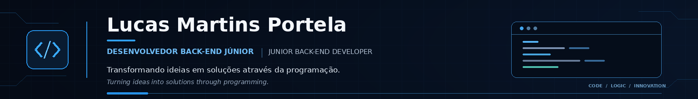

# Olá! Eu sou Lucas Martins Portela 👋
### Desenvolvedor Back-end Júnior | Junior Back-end Developer

**Transformando ideias em soluções através da programação.**  
*Turning ideas into solutions through programming.*

<!-- Adicione aqui seu LinkedIn e e-mail profissional quando quiser divulgá-los publicamente. -->

---

## 👨‍💻 Sobre mim | About me

**PT-BR**

Sou desenvolvedor em formação, com foco em desenvolvimento back-end e interesse em construir aplicações úteis, organizadas e bem documentadas. Venho desenvolvendo projetos práticos para aprimorar minha lógica de programação, manipulação de dados, criação de APIs e integração entre back-end e interfaces web.

Gosto de aprender colocando a mão no código, investigar problemas e transformar requisitos em funcionalidades.

**EN**

I'm an aspiring developer focused on back-end development and interested in building useful, well-organized, and well-documented applications. I work on practical projects to improve my programming logic, data handling, API development, and integration between back-end services and web interfaces.

I enjoy learning by building, troubleshooting problems, and turning requirements into working features.

## 🧰 Tecnologias e ferramentas | Tech stack

**Linguagens | Languages**

**Back-end, banco de dados e ferramentas | Back-end, databases & tools**

**Front-end | Interface**

> As tecnologias acima representam ferramentas presentes nos meus estudos e projetos.  
> The technologies above represent tools used across my learning journey and projects.

## 🚀 Projetos em destaque | Featured projects

Projetos selecionados do meu portfólio. Consulte cada repositório para ver código, requisitos e instruções de execução.  
Selected projects from my portfolio. Visit each project folder for source code and setup instructions.

| Projeto | Descrição |
|---|---|
| [Sistema de Auditoria de Eventos](https://github.com/lucasmportela/lucasmportela/tree/main/PROJETOS/AuditoriaDeEventosSistema) | Registro e consulta de eventos, com data, hora, usuário, ação e status. |
| [Sistema de Autenticação](https://github.com/lucasmportela/lucasmportela/tree/main/PROJETOS/SistemaAutenticacao) | Demonstração de autenticação, validação e controle de tentativas. |
| [Controle de Reposição de Almoxarifado](https://github.com/lucasmportela/lucasmportela/tree/main/PROJETOS/ControleReposicaoAlmoxarifado) | Controle de estoque e identificação de itens que precisam de reposição. |
| [Sistema de Faturamento de Produtos](https://github.com/lucasmportela/lucasmportela/tree/main/PROJETOS/SistemaDeFaturamentoDeProdutos) | Cadastro de produtos e operações de faturamento. |
| [Monitoramento de Data Center](https://github.com/lucasmportela/lucasmportela/tree/main/PROJETOS/MonitoramenteHackDataCenter) | Projeto voltado ao acompanhamento de infraestrutura de servidores. |
| [Monitoramento de Baterias](https://github.com/lucasmportela/lucasmportela/tree/main/PROJETOS/MonitoramentoDeBaterias) | Monitoramento de carga com validação de valores e regras de negócio. |

**Outros projetos | Other projects:** [Auditoria de Consumo de Combustível](https://github.com/lucasmportela/lucasmportela/tree/main/PROJETOS/AuditoriaConsumoCombustivel) · [Auditoria Energética Industrial](https://github.com/lucasmportela/lucasmportela/tree/main/PROJETOS/AuditoriaEnergeticaIndustrial) · [Cadastro de Funcionários](https://github.com/lucasmportela/lucasmportela/tree/main/PROJETOS/CadastroFuncionariosEscola) · [Jogo de Adivinhação](https://github.com/lucasmportela/lucasmportela/tree/main/PROJETOS/JogoAdivinhacao) · [Sistema de Vendas](https://github.com/lucasmportela/lucasmportela/tree/main/PROJETOS/SistemaVendas)

> **Nota:** os links dos projetos consideram a estrutura `PROJETOS/` do pacote organizado. Se você publicar as pastas em outro repositório ou caminho, atualize os links acima.

## 📊 GitHub | Estatísticas

  
  

  

## 🎯 Objetivos | Goals

- Aprofundar meus conhecimentos em Python e desenvolvimento back-end.  
  *Deepen my knowledge of Python and back-end development.*
- Desenvolver APIs organizadas, seguras e documentadas.  
  *Build well-structured, secure, and documented APIs.*
- Praticar bancos de dados, testes automatizados e boas práticas.  
  *Practice databases, automated testing, and software engineering best practices.*
- Colaborar em projetos e evoluir como profissional.  
  *Contribute to projects and grow as a software developer.*

## 📫 Contato | Contact

- **GitHub:** [@lucasmportela](https://github.com/lucasmportela)
- **LinkedIn:** [lucasmartinsportela](https://www.linkedin.com/in/lucasmartinsportela/)
- **E-mail:** lucmartport@hotmail.com

### Obrigado pela visita! | Thanks for visiting!

**"Grandes conquistas começam com um bom código."**  
*“Great achievements begin with good code.”*

