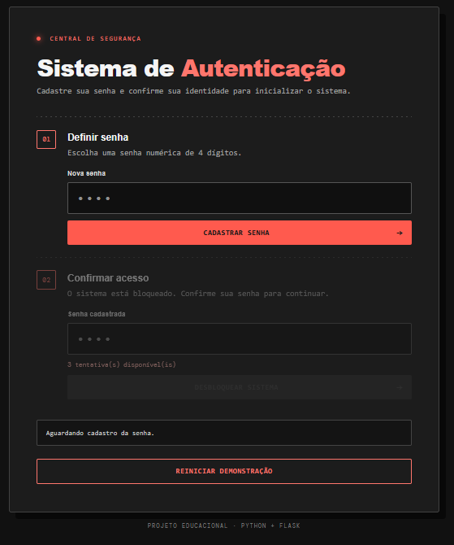
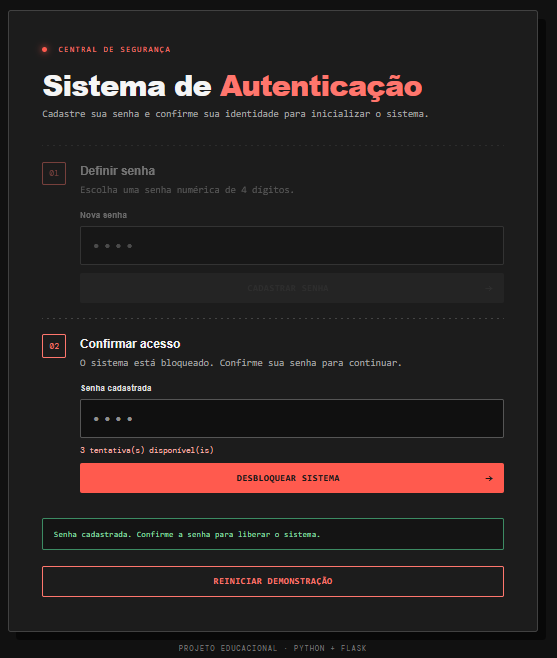
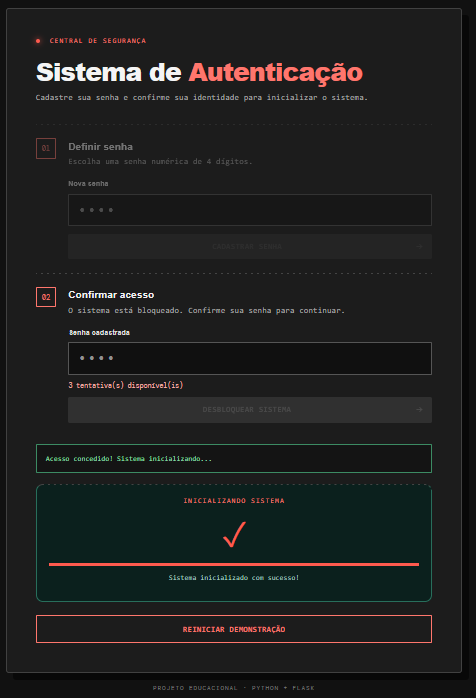
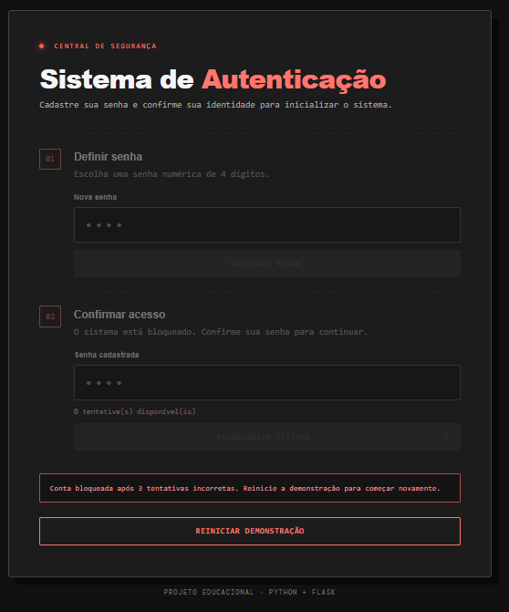

# Sistema de Autenticação

Aplicação web que transforma um exercício de autenticação feito em Python no terminal em uma interface web com frontend e backend.

O usuário cadastra uma senha numérica de quatro dígitos. Em seguida, o sistema solicita a confirmação da senha, permite até três tentativas e, quando o acesso é liberado, executa uma contagem regressiva de inicialização de 5 até 1.

## Funcionalidades

- Cadastro de senha numérica com exatamente 4 dígitos.
- Validação no backend.
- Até 3 tentativas para confirmar a senha.
- Bloqueio após 3 tentativas incorretas.
- Contagem regressiva de inicialização após autenticação bem-sucedida.
- Reinicialização da demonstração.
- Senha armazenada como hash, sem texto puro.

## Demonstração Visual

### Tela Inicial (Vazia)
Aguardando o cadastro da senha.


### Tela Cadastro
Tela após o cadastramento da senha.


### Tela Sucesso
Sucesso ao colocar a senha correspondente e inicializar o sistema.


### Tela Bloqueio
Bloqueamento de conta após 3 tentativas sem exito ao digitar a senha.


## Tecnologias

- **Backend:** Python e Flask.
- **Frontend:** HTML5, CSS3 e JavaScript.
- **Comunicação:** API HTTP com JSON.

## Estrutura de pastas

```text
SistemaAutenticacao/
├── backend/
│   ├── app.py
│   ├── requirements.txt
│   └── tests/
│       └── test_security.py
├── frontend/
│   ├── index.html
│   ├── style.css
│   └── app.js
└── README.md
```

## Como executar

### Pré-requisitos

- Python 3.10 ou superior.
- pip.

### 1. Clone o repositório e entre na pasta do projeto

```bash
git clone https://github.com/lucasmportela/lucasmportela.git
cd lucasmportela/SistemaAutenticacao
```

### 2. Crie e ative um ambiente virtual (recomendado)

Windows PowerShell:

```powershell
python -m venv .venv
.venv\Scripts\Activate.ps1
```

Se o PowerShell bloquear a ativação, você pode executar diretamente o pip e o Python do ambiente virtual, ou usar o Prompt de Comando.

### 3. Instale as dependências

```bash
pip install -r backend/requirements.txt
```

### 4. Configure a chave de sessão

Em desenvolvimento, se `SECRET_KEY` não estiver definida, o aplicativo gera uma chave aleatória temporária. As sessões serão invalidadas quando o servidor for reiniciado.

Para manter uma chave estável durante seus testes, defina uma variável de ambiente antes de iniciar o servidor.

Windows PowerShell:

```powershell
$env:SECRET_KEY = (python -c "import secrets; print(secrets.token_urlsafe(32))")
```

Linux/macOS:

```bash
export SECRET_KEY="$(python -c 'import secrets; print(secrets.token_urlsafe(32))')"
```

Não publique, envie por commit ou compartilhe o valor dessa chave.

### 5. Inicie o backend

A partir da pasta `SistemaAutenticacao`:

```bash
python backend/app.py
```

O modo Debug fica desativado por padrão. Para habilitá-lo apenas durante o desenvolvimento local, defina `FLASK_DEBUG=true`.

### 6. Acesse no navegador

Abra:

```text
http://127.0.0.1:5000
```

## Como testar manualmente

1. Cadastre uma senha de quatro dígitos, por exemplo `1234`.
2. Confirme a senha na etapa de acesso.
3. Teste uma senha incorreta para visualizar a redução das tentativas.
4. Com a senha correta, acompanhe a contagem regressiva de 5 até 1.
5. Use **Reiniciar demonstração** para limpar a sessão e começar novamente.
6. Para testar o bloqueio, cadastre uma senha e erre as três tentativas.

## Testes automatizados

Execute a partir da pasta `SistemaAutenticacao`:

```bash
python -m unittest discover -s backend/tests -v
```

Os testes verificam a configuração segura padrão, os atributos do cookie de sessão, o cadastro de senha, a autenticação e o bloqueio após três tentativas incorretas.

## Rotas da API

| Método | Rota | Descrição |
|---|---|---|
| GET | `/api/status` | Consulta o estado da sessão. |
| POST | `/api/setup` | Cadastra a senha de quatro dígitos. |
| POST | `/api/login` | Confirma a senha e controla as tentativas. |
| POST | `/api/reset` | Reinicia a sessão da demonstração. |

Exemplo de corpo JSON para cadastro e login:

```json
{
  "password": "1234"
}
```

## Regras de negócio implementadas

- A senha deve conter exatamente quatro caracteres numéricos.
- O backend permite três tentativas de autenticação.
- Uma tentativa correta libera o acesso.
- Uma tentativa incorreta reduz o total de tentativas restantes.
- Ao chegar a zero, a sessão fica bloqueada.
- A contagem regressiva só acontece depois da autenticação bem-sucedida.

## Segurança e limitações

Este projeto é educacional e não deve ser utilizado para proteger contas reais.

- A chave Flask não é mais fixa no código. Em desenvolvimento, uma chave aleatória temporária é gerada quando `SECRET_KEY` não está definida. Em produção, `APP_ENV=production` exige uma chave configurada com pelo menos 32 caracteres.
- O modo Debug fica desativado por padrão e é forçado a permanecer desligado quando `APP_ENV=production`.
- Os cookies de sessão usam `HttpOnly` e `SameSite=Lax`; em produção, também usam `Secure`, exigindo HTTPS.
- **Limitação importante:** a sessão padrão do Flask é assinada, mas não criptografada. Portanto, o hash da senha armazenado na sessão pode ser lido pelo cliente. Como a senha tem apenas quatro dígitos, este fluxo não é adequado para autenticação real. Uma aplicação de produção deve usar armazenamento de sessão no servidor, credenciais mais fortes, proteção contra CSRF, limitação de tentativas por usuário/IP e HTTPS.
- O bloqueio deste exemplo é por sessão/navegador, não um mecanismo de proteção para contas reais.

Para produção, configure `APP_ENV=production`, forneça `SECRET_KEY` por um gerenciador de segredos e utilize um servidor WSGI apropriado em HTTPS. Não use o servidor de desenvolvimento do Flask em produção.

## Autor

Desenvolvido como projeto de estudo de lógica de programação, Python, APIs e desenvolvimento web.
