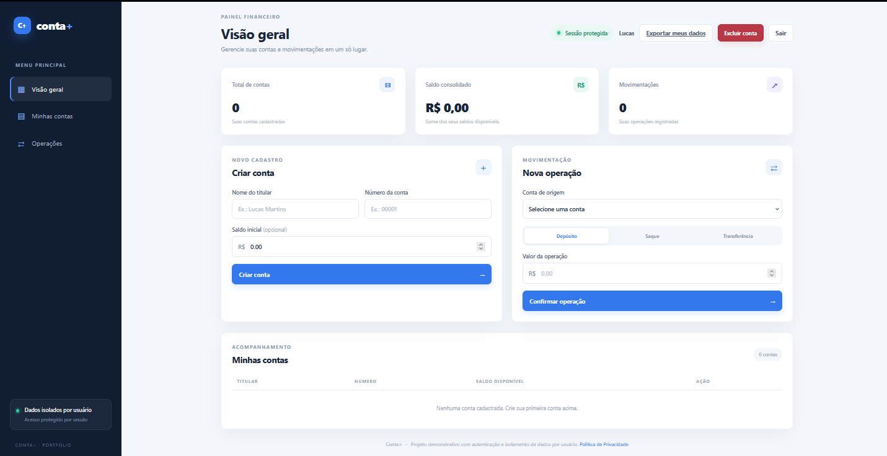
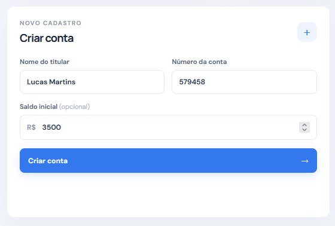
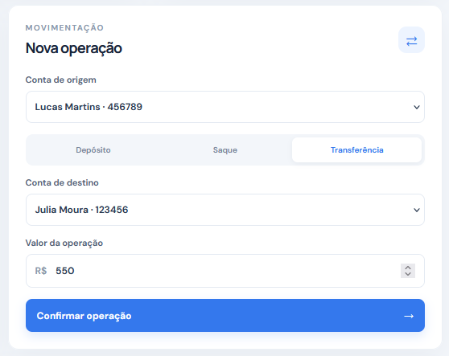
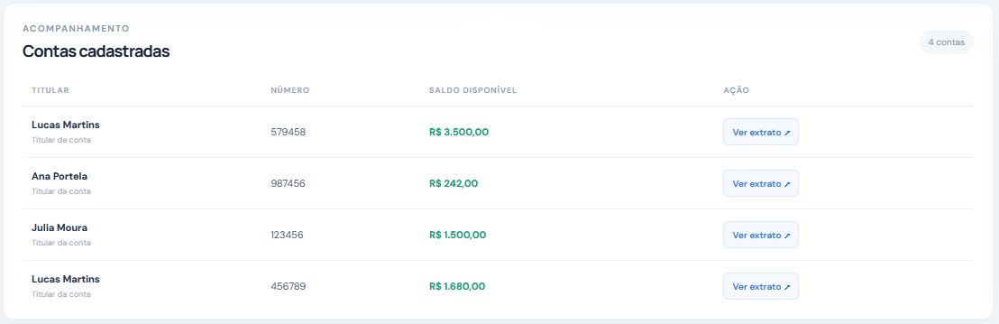
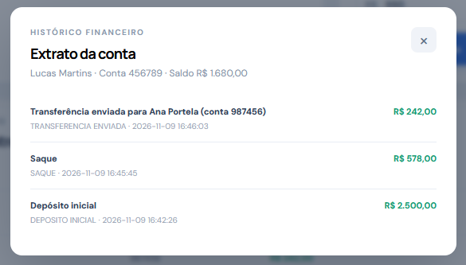

# Conta+ — Sistema de Contas Bancárias

Aplicação web demonstrativa para gerenciamento de contas bancárias, desenvolvida a partir de um exercício de Programação Orientada a Objetos em Python. O projeto permite cadastrar contas, realizar depósitos, saques e transferências, além de consultar o extrato de movimentações.

> **Aviso:** este é um projeto educacional para portfólio. Não é um sistema bancário real e não deve ser utilizado para armazenar dinheiro ou dados financeiros verdadeiros.

## ✨ Funcionalidades

- Cadastro de contas com titular, número e saldo inicial.
- Validação de nomes, números de conta e valores.
- Depósitos com atualização automática do saldo.
- Saques com bloqueio de saldo insuficiente.
- Transferências entre contas diferentes.
- Bloqueio de transferência para a própria conta.
- Extrato individual com histórico das movimentações.
- Painel com total de contas, saldo consolidado e quantidade de movimentações.
- Persistência local dos dados em SQLite.
- Interface responsiva para desktop e dispositivos móveis.

## 📸 Demonstração Visual

### Tela Inicial (Vazia)
Tela inicial do programa aguardando as primeiras entradas de dados para serem processados com a exibição de total de contas cadastradas, saldo consolidado de todas as contas e número total de movimentações registradas.


### Tela Cadastro
Seção cadastro aguardando os dados nome do titular, número da conta e saldo inicial para cadastrar uma nova conta.


### Tela Operação
Operação de movimentação de conta com as opções saque, depósito ou transferência para outra conta com especificação de conta e valor da operação.


### Tela Acompanhamento
Informações das contas cadastradas como saldo, nome do titular e número de conta.


### Histórico Financeiro
Extrato de uma conta específica exibindo nome do titular, número da conta, saldo atual e transações realizadas com detalhes, data e horário.


As capturas de tela utilizadas neste README estão armazenadas em `docs/screenshots/`.

## 🧰 Tecnologias utilizadas

**Back-end**
- Python
- Flask
- SQLite
- Decimal para cálculos monetários

**Front-end**
- HTML5
- CSS3
- JavaScript (Fetch API)

## 📁 Estrutura do projeto

```text
conta-mais/
├── app.py
├── conta.py
├── database.py
├── requirements.txt
├── .gitignore
├── README.md
├── instance/
│   └── contas.db             # Criado automaticamente ao iniciar
├── templates/
│   └── index.html
├── static/
│   ├── css/
│   │   └── style.css
│   └── js/
│       └── app.js
├── tests/
│   ├── test_conta.py
│   ├── test_api.py
│   └── test_database.py
└── docs/
    └── screenshots/
        ├── tela-inicial.png
        ├── novo-cadastro.png
        ├── tela-operacao.png
        ├── tela-acompanhamento.png
        ├── historico-financeiro.png
        └── .gitkeep
```

## ⚙️ Como executar

### 1. Pré-requisitos

- Python 3.10 ou superior.
- pip.

### 2. Clone o repositório e entre na pasta do projeto

```bash
git clone https://github.com/lucasmportela/conta-mais.git
cd conta-mais
```

### 3. Crie o ambiente virtual e instale as dependências

Windows PowerShell:

```powershell
py -m venv .venv
.\.venv\Scripts\python.exe -m pip install -r requirements.txt
```

Windows Prompt de Comando:

```cmd
py -m venv .venv
.venv\Scripts\python.exe -m pip install -r requirements.txt
```

Linux/macOS:

```bash
python3 -m venv .venv
source .venv/bin/activate
python -m pip install -r requirements.txt
```

### 4. Inicie o servidor

Windows PowerShell:

```powershell
.\.venv\Scripts\python.exe app.py
```

Windows Prompt de Comando:

```cmd
.venv\Scripts\python.exe app.py
```

Linux/macOS:

```bash
python app.py
```

O modo Debug fica desativado por padrão. Para habilitá-lo durante desenvolvimento local, defina `FLASK_DEBUG=true`. Quando `APP_ENV=production`, o modo Debug permanece desativado.

### 5. Abra a aplicação

Acesse no navegador:

```text
http://127.0.0.1:5000
```

O banco SQLite e as tabelas são criados automaticamente na primeira execução.

## 🔌 API REST

| Método | Rota | Descrição |
|---|---|---|
| GET | `/api/health` | Verifica se a API está ativa |
| GET | `/api/resumo` | Retorna os indicadores do painel |
| GET | `/api/contas` | Lista todas as contas |
| POST | `/api/contas` | Cria uma conta |
| POST | `/api/contas/<id>/depositos` | Realiza depósito |
| POST | `/api/contas/<id>/saques` | Realiza saque |
| POST | `/api/contas/<id>/transferencias` | Realiza transferência |
| GET | `/api/contas/<id>/extrato` | Consulta o extrato |

### Exemplo de criação de conta

```json
{
  "nome": "Lucas Martins",
  "numero": "00001",
  "saldo_inicial": "150.00"
}
```

### Exemplo de depósito ou saque

```json
{
  "valor": "50.00"
}
```

### Exemplo de transferência

```json
{
  "conta_destino_id": 2,
  "valor": "25.00"
}
```

## 🧪 Testes automatizados

A suíte utiliza `unittest` e o cliente de testes do Flask. Os testes de integração criam bancos SQLite temporários, isolados dos dados locais da aplicação.

**Cobertura:**

- **Testes unitários (`test_conta.py`):** regras de depósito, saque, transferência e validação de valores.
- **Testes das rotas (`test_api.py`):** página inicial, health check, cadastro, duplicidade de conta, depósitos, saques, transferências, extratos, resumo e respostas de erro.
- **Testes do banco (`test_database.py`):** criação das tabelas, persistência, commit, rollback, unicidade do número da conta e integridade referencial.

Execute toda a suíte a partir da pasta `SistemaContasBancarias`:

```bash
python -m unittest discover -s tests -v
```

No Windows, sem ativar o ambiente virtual:

```powershell
.\.venv\Scripts\python.exe -m unittest discover -s tests -v
```

Os mesmos testes são executados automaticamente pelo GitHub Actions a cada push ou pull request direcionado à branch `main`.

## 🧠 Regras de negócio

- O nome do titular deve conter pelo menos 3 caracteres.
- O número da conta deve ser único.
- O saldo inicial pode ser zero ou positivo.
- Depósitos, saques e transferências exigem valores maiores que zero.
- Não é permitido sacar ou transferir um valor superior ao saldo disponível.
- Uma conta não pode transferir para ela mesma.
- Os valores monetários são tratados com `Decimal` para evitar imprecisões comuns de ponto flutuante.
- Cada movimentação é registrada no extrato da conta correspondente.

## 🔒 Limitações e segurança

Este projeto foi criado para fins de estudo e não deve ser exposto publicamente como um serviço financeiro.

- **Não há autenticação nem autorização de usuários.** Qualquer pessoa que consiga acessar a aplicação pode listar contas, consultar extratos e realizar operações em todas as contas cadastradas.
- Não existe isolamento de dados por usuário ou titular.
- Não insira dados pessoais, bancários ou financeiros reais.
- O modo Debug fica desativado por padrão; o servidor local escuta em `127.0.0.1`.
- Antes de qualquer uso real seriam necessários autenticação, autorização por conta, proteção CSRF, controles de concorrência, auditoria, gestão segura de dados, HTTPS e implantação com servidor de produção.

## 👨‍💻 Autor

**Lucas Martins Portela**  
Desenvolvedor Back-end Júnior

- GitHub: [@lucasmportela](https://github.com/lucasmportela)

---

Desenvolvido para praticar Python, orientação a objetos, APIs REST, persistência de dados e integração entre front-end e back-end.
