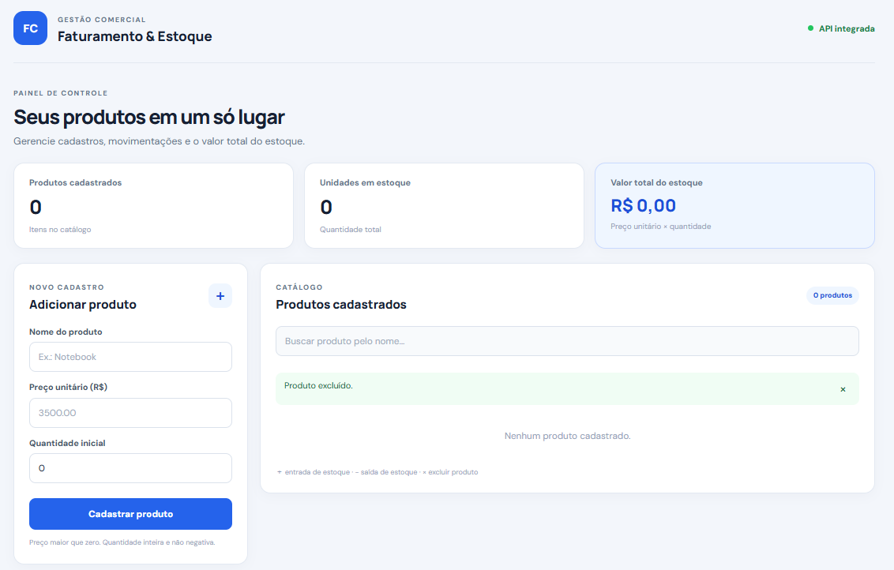
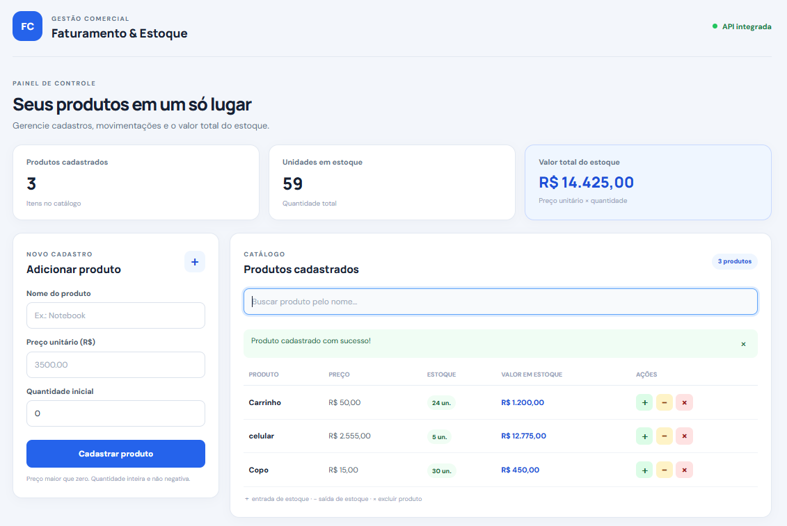

# 💼 Sistema de Faturamento Comercial — Cadastro e Controle de Estoque

Aplicação Full Stack desenvolvida a partir de um exercício de Python sobre Programação Orientada a Objetos. O sistema permite cadastrar produtos, controlar entradas e saídas de estoque e calcular o valor total armazenado.

As regras de negócio são protegidas no backend por meio de encapsulamento, `@property` e setters da classe `Produto`.

## Funcionalidades

- Cadastro e consulta de produtos.
- Validação de preço maior que zero.
- Validação de quantidade inteira e não negativa.
- Entrada de estoque.
- Saída de estoque com verificação de saldo.
- Cálculo do valor total por produto (`preço × quantidade`).
- Cálculo do valor total de todo o estoque.
- Busca por nome e exclusão de produtos.
- Persistência dos dados em arquivo JSON.

## 📸 Demonstração Visual

### Tela Inicial (Vazia)
Aguardando o registro do produto com o seu nome, valor unitário e quantidade.


### Tela Registro
Contém a quantidade de tipos de produtos, unidades e valor total de estoque. Registro dos produtos cadastrados contendo um catálogo com preço, estoque e valor total em estoque. Com opções de adicionar, subtrair ou excluir os produtos cadastrados.


Os dados cadastrados são gravados em `backend/data/produtos.json`, criado automaticamente na primeira execução. Esse arquivo contém dados locais e não é enviado ao repositório individual.

## Tecnologias

**Backend:** Python, Flask, Flask-CORS, JSON.  
**Frontend:** React, JavaScript, Webpack, Babel, HTML e CSS.

## Estrutura

```text
sistema-faturamento-produtos/
├── backend/
│   ├── data/                # criado automaticamente pelo backend
│   ├── app.py
│   ├── produto.py
│   ├── repositorio.py
│   └── requirements.txt
├── frontend/
│   ├── public/
│   │   └── index.html
│   ├── src/
│   │   ├── App.jsx
│   │   ├── index.jsx
│   │   └── style.css
│   ├── package.json
│   └── webpack.config.js
├── .gitignore
└── README.md
```

## Regras de negócio

- `Produto(nome, preco, quantidade=0)` inicializa o objeto validando os atributos pelas propriedades.
- `preco` é armazenado em `_preco` e só aceita valor maior que zero.
- `quantidade` é armazenada em `_quantidade` e só aceita inteiro não negativo.
- `valor_total_estoque` é uma propriedade somente-leitura que calcula preço × quantidade.
- `adicionar_estoque(quantidade)` retorna `True` quando adiciona uma quantidade inteira positiva.
- `remover_estoque(quantidade)` retorna `True` somente quando a quantidade é válida e existe saldo suficiente.

## Como executar

### Pré-requisitos

- Python 3.10 ou superior
- Node.js e npm

### 1. Clonar o repositório

```bash
git clone https://github.com/lucasmportela/sistema-faturamento-produtos.git
cd sistema-faturamento-produtos
```

### 2. Iniciar o backend

No terminal:

```powershell
cd backend
py -m venv .venv
```

Instale as dependências:

```powershell
.\.venv\Scripts\python.exe -m pip install -r requirements.txt
```

Inicie a API:

```powershell
.\.venv\Scripts\python.exe app.py
```

Backend: `http://127.0.0.1:5000`

### 3. Iniciar o frontend

Abra um segundo terminal:

```powershell
cd frontend
npm.cmd install
npm.cmd start
```

Frontend: `http://localhost:3000`

> No PowerShell do Windows, use `npm.cmd` para evitar o bloqueio de execução do arquivo `npm.ps1`.

## 🔒 Configuração de segurança

- O CORS não aceita qualquer origem. Por padrão, somente `http://localhost:3000` e `http://127.0.0.1:3000` podem acessar a API por chamadas cross-origin.
- Para autorizar outro endereço, defina `CORS_ORIGINS` com uma lista separada por vírgulas contendo apenas as origens confiáveis. Exemplo no PowerShell: `$env:CORS_ORIGINS = "https://meu-frontend.example.com"`.
- O modo Debug fica desativado por padrão. `FLASK_DEBUG=true` só deve ser usado em desenvolvimento local; quando `APP_ENV=production`, o Debug permanece desligado.
- O servidor de desenvolvimento escuta em `127.0.0.1` por padrão. Em produção, use um servidor WSGI apropriado e configure HTTPS, domínio e origens CORS explicitamente.
- O frontend local utiliza o proxy do Webpack para encaminhar `/api` ao backend; por isso, durante esse fluxo, o navegador normalmente faz requisições same-origin.

## Endpoints da API

| Método | Rota | Descrição |
|---|---|---|
| GET | `/api/health` | Verifica o status da API |
| GET | `/api/produtos` | Lista produtos e valor total do estoque |
| POST | `/api/produtos` | Cadastra produto |
| PUT | `/api/produtos/<id>` | Atualiza produto |
| DELETE | `/api/produtos/<id>` | Exclui produto |
| POST | `/api/produtos/<id>/estoque/adicionar` | Adiciona estoque |
| POST | `/api/produtos/<id>/estoque/remover` | Remove estoque |

### Exemplo de cadastro

`POST /api/produtos`

```json
{
  "nome": "Notebook",
  "preco": 3500.00,
  "quantidade": 10
}
```

### Exemplo de movimentação

`POST /api/produtos/1/estoque/remover`

```json
{
  "quantidade": 3
}
```

## Testes automatizados

Os testes usam `unittest` e o cliente de testes do Flask. A API utiliza um arquivo JSON temporário por teste, evitando alterar os dados locais do projeto.

Execute na raiz do projeto:

```bash
python -m unittest discover -s backend/tests -v
```

A suíte verifica a configuração de segurança e as rotas de saúde, cadastro, listagem, validação, movimentação de estoque, atualização, exclusão e persistência. O GitHub Actions executa os testes, a verificação de sintaxe Python e o build do frontend.

## Conceitos praticados

- Classes e objetos.
- Encapsulamento e atributos protegidos.
- Decoradores `@property` e `@setter`.
- Propriedades somente-leitura.
- Validação e tratamento de erros.
- Métodos de instância.
- Criação de API REST.
- Integração frontend/backend.
- Persistência em JSON.

## Autor

Projeto desenvolvido para fins de estudo em Python, Programação Orientada a Objetos e desenvolvimento Full Stack.
